# Repository Audit

## Overview

This document captures the state of the **Zero Trust Architecture Simulator** repository as of the initial inspection. It serves as the baseline for all subsequent implementation phases.

## Directory Structure

```mermaid
graph TD
    A[app/] --> B[api/]
    A --> C[core/]
    A --> D[db/]
    A --> E[models/]
    A --> F[schemas/]
    A --> G[services/]
    A --> H[frontend/]
    A --> I[tests/]
    
    B --> B1[routes.py]
    B --> B2[deps.py]
    C --> C1[config.py]
    D --> D1[init_db.py]
    D --> D2[session.py]
    E --> E1[user.py]
    E --> E2[auth.py]
    E --> E3[audit.py]
    E --> E4[policy.py]
    F --> F1[auth.py]
    F --> F2[policy.py]
    F --> F3[audit.py]
    F --> F4[dashboard.py]
    G --> G1[security.py]
    G --> G2[policy_engine.py]
    G --> G3[rbac.py]
    G --> G4[audit.py]
    H --> H1[App.tsx]
    H --> H2[main.tsx]
    H --> H3[App.css]
    H --> H4[index.css]
    I --> I1[conftest.py]
    I --> I2[test_auth.py]
    I --> I3[test_authorization_policy.py]
    I --> I4[test_audit_and_integration.py]
```



## What Already Works

| Feature | Status | Notes |
|---------|--------|-------|
| FastAPI app startup | Working | `create_app()` creates tables, seeds defaults |
| JWT token creation and verification | Working | HS256, access tokens with JTI, expiration |
| Password hashing (argon2) | Working | `verify_password`/`get_password_hash` |
| User login/logout | Working | Rate-limited, audit-logged, token revocation on logout |
| Three-role RBAC (VIEWER/ANALYST/ADMIN) | Working | Explicit permission mappings in `rbac.py` |
| Token revocation | Working | JTI-based revocation check, logout revokes token |
| Audit logging | Working | All auth + access decisions logged |
| Default demo users | Working | viewer/analyst/admin with hardcoded passwords |
| Policy evaluation (device trust, MFA, risk threshold) | Working | High-sensitivity resources require signals |
| React frontend dashboard | Working | Protected data load, login/logout, policy eval |
| Security test scenarios | Working | 9 scenarios in `run_security_tests` endpoint |
| Database seeded with 3 users | Working | Via `init_defaults()` on startup |

## What Is Missing or Needs Improvement

| Category | Item | Priority |
|----------|------|----------|
| **Documentation** | `docs/REPOSITORY_AUDIT.md` | 1 (creating now) |
| | `docs/IMPLEMENTATION_PLAN.md` | 1 |
| | `docs/FEATURE_TRACEABILITY.md` | 1 |
| | `docs/TEST_STRATEGY.md` | 1 |
| | `docs/DECISIONS.md` | 1 |
| | `PROJECT_STATUS.md` | 1 |
| **Testing** | Missing: revoked token test | 2 |
| | Missing: malformed token test | 2 |
| | Missing: unauthorized resource access test | 2 |
| | Missing: PDF report generation tests | 3 |
| **Security** | Hardcoded demo passwords in `init_db.py` | 2 |
| | CORS not configured (allow all by default) | 2 |
| | No HTTPS/TLS configuration for local dev | 3 |
| **Configuration** | `.env.example` JWT secret needs rotation guidance | 2 |
| | Database uses SQLite - acceptable for educational local sim | 2 |
| **Frontend** | No explicit authorization enforcement beyond frontend visibility | 2 |
| | No 401/403 error state handling granularity | 3 |
| | Report download not implemented | 3 |
| **Backend** | No OpenAPI specification document | 3 |
| | Rate limiter is in-memory only (not persistent across restarts) | 3 |
| | Password complexity enforcement only via Pydantic min_length | 2 |
| **Docker** | No Dockerfile or docker-compose.yaml | 2 |
| **Reports** | No PDF report generation | 3 |
| **Traceability** | No feature-to-implementation mapping matrix | 1 |

## Repository Health Score

| Metric | Score | Notes |
|--------|-------|-------|
| Code functionality | 8/10 | Core features work but have gaps |
| Test coverage | 5/10 | 3 test files, ~20 test functions, missing scenarios |
| Documentation | 2/10 | Only README.md exists; no docs/ folder initially |
| Security posture | 6/10 | Hardcoded demo passwords, no CORS, in-memory rate limit |
| Reproducibility | 6/10 | SQLite works locally; no Docker config |
| Configuration management | 5/10 | `.env.example` exists but JWT secret not rotated |
| Frontend/backend parity | 7/10 | API client in frontend matches backend endpoints |
| **Overall** | **6.2/10** | Solid foundation; needs docs, tests, Docker, reports |

## Immediate Blockers

1. **No `docs/` directory** - required documentation files must be created
2. **No PROJECT_STATUS.md** - progress tracking required
3. **Tests may fail** if dependencies not installed or DB path issues
4. **No Docker configuration** - required for containerized workflow
5. **Intermediate/final reports** not generated
```